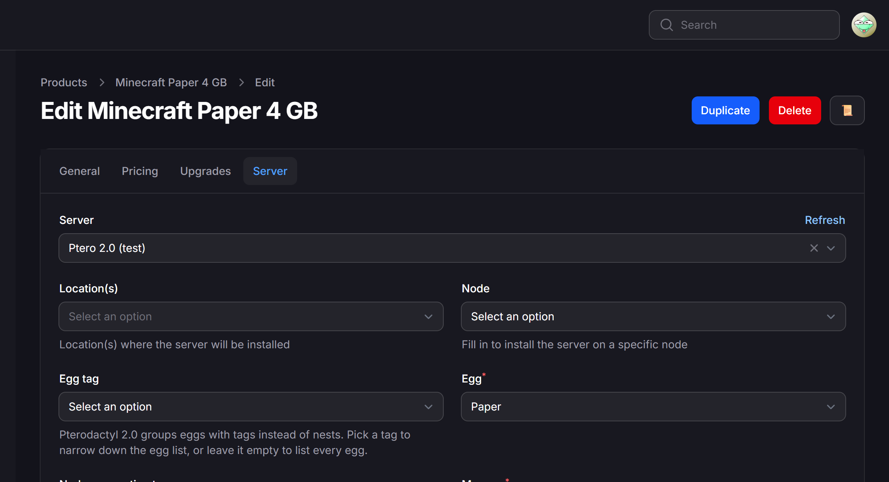

# Pterodactyl 2.0 for Paymenter

**A drop-in Paymenter server extension that works with Pterodactyl 2.0 and Pterodactyl 1.x.**

Pterodactyl 2.0 removed the Application API's nest endpoints. Paymenter's built-in Pterodactyl extension still calls them, so after you upgrade the panel, new orders, upgrades and the product page in the admin area fail with:

```
The route api/application/nests/1/eggs/1 could not be found.
```

This extension fixes that. It detects the panel version on its own and uses eggs and tags on 2.0 and nests on 1.x, so you can install it before you upgrade the panel and nothing changes for your customers.



Free and open source (MIT). Tested against Pterodactyl v2.0.0-beta.2, Pterodactyl v1.15.1 and Paymenter v1.5.9.

Download from the [GitHub releases](https://github.com/ziroxonline111/paymenter-pterodactyl-v2/releases/latest) or the [SourceXchange listing](https://www.sourcexchange.net/products/pterodactyl-2-for-paymenter). Both have the same release zip.

## What it does

- **Works with Pterodactyl 1.x and 2.0** from the same settings. The version is detected automatically (and cached for 10 minutes).
- **Keeps your products.** It uses the same server settings (URL and API key) and the same product options as the built-in extension. Egg IDs do not change in the Pterodactyl 2.0 upgrade, so existing products keep their egg.
- **Eggs by tag on 2.0.** Pterodactyl 2.0 groups eggs with tags instead of nests. The product page has a tag filter, and a product created on 1.x starts on the tag that replaced its nest.
- **Node reservation tags.** If you reserve nodes for tags in Pterodactyl 2.0, a product can opt in to them for automatic deployment.
- **Everything else as before:** locations, a fixed node, port arrays, port ranges, dedicated IPs, egg variables from config options, upgrades, suspend, unsuspend and terminate.
- **Clearer errors.** When the panel says no, the message shows the HTTP status and the panel's reason instead of a PHP error.

## Install

1. Download the latest release (GitHub or SourceXchange) and copy the `Pterodactyl2` folder to `extensions/Servers/` in your Paymenter directory, so that you have `extensions/Servers/Pterodactyl2/Pterodactyl2.php`.
   - Docker: copy it into the `extensions/Servers/` folder of the volume or bind mount that holds `/app/extensions`.
2. In Paymenter, go to **Admin → Servers**. Your existing Pterodactyl server stays as it is for now.

### Switch existing servers (one command)

The settings are identical, so switching only changes which extension a server uses. Your products, services and settings stay as they are.

```bash
php artisan tinker --execute="App\Models\Server::where('extension','Pterodactyl')->update(['extension'=>'Pterodactyl2']);"
```

Docker:

```bash
docker compose exec paymenter php artisan tinker --execute="App\Models\Server::where('extension','Pterodactyl')->update(['extension'=>'Pterodactyl2']);"
```

To switch back, swap the two names in the command.

### Or add a new server

**Admin → Servers → New**, choose **Pterodactyl 2.0**, enter the panel URL and an Application API key, and click **Test Connection**. Then point your products at the new server.

## API key permissions

Create the key in Pterodactyl under **Admin → API** (Application API). It needs read and write access to servers, users, nodes, locations, allocations and eggs, the same as the built-in extension. On Pterodactyl 2.0, read access to tags adds the tag filter; without it the product page lists every egg.

## Upgrading the panel to 2.0

1. Install this extension and switch your servers (above) while the panel is still on 1.x. Nothing changes yet.
2. Upgrade Pterodactyl with the [official guide](https://docs.pterodactyl.io/v2/upgrading/upgrading-from-v1). Its step "Update Your Billing Module" is this extension.
3. In Paymenter, open **Admin → Servers → your server → Test Connection**. It detects 2.0 from now on.
4. Open one product and check that the egg is still selected. Products that used a custom nest with a single egg get no tag in 2.0, but they keep their egg.

## Troubleshooting

| Message | What to do |
|---|---|
| `The route api/application/nests/... could not be found` | The server still uses the built-in extension. Switch it (see above). |
| `Pterodactyl answered HTTP 403` | The API key lacks a permission. Give it read and write on the resources listed above. |
| `Node is not suitable for deployment` | The node in the product has too little free memory or disk, or no free allocations. |
| `The port array needs a SERVER_PORT entry` | The product's port array must name `SERVER_PORT`. |
| Product page shows no eggs | Click **Test Connection** on the server once. The panel version is cached for 10 minutes. |

Step-by-step guide with the background: [Fix Paymenter after upgrading to Pterodactyl 2.0](https://karelialabs.com/guides/paymenter-pterodactyl-2-nests-not-found).

## Karelia Bridge (optional, paid)

The same team makes **Karelia Bridge**, an add-on for Paymenter and Pterodactyl 2.0:

- **One-click sign-in.** The customer clicks *Open control panel* in Paymenter and lands on their server, signed in. No second password.
- **Billing inside the panel.** A *Billing* page on every server shows the next due date, the price and unpaid invoices with a *Pay now* button.
- **Warnings where customers look.** A banner above the console before an invoice is due and when the server is about to be suspended, and a *Due in 2 d* badge on the server list.

It uses Pterodactyl 2.0's official extension system, so no panel files are edited. Details: https://karelialabs.com/tools/karelia-bridge · Download: https://karelialabs.gumroad.com/l/karelia-bridge

## License

MIT. Based on Paymenter's built-in Pterodactyl extension (MIT, © Paymenter). See [LICENSE](LICENSE).

Not affiliated with Paymenter or Pterodactyl. "Pterodactyl" and "Paymenter" are used only to describe compatibility.
